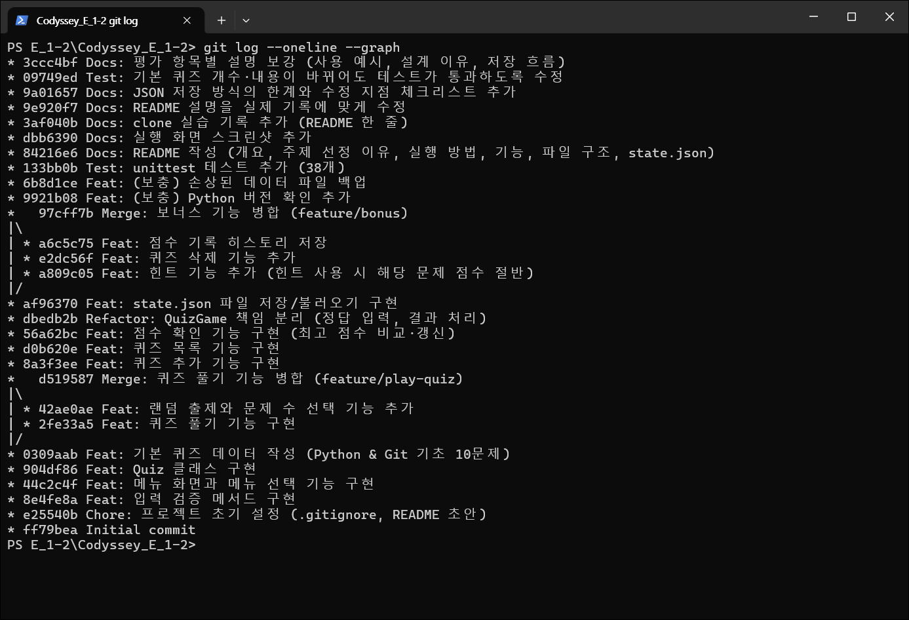
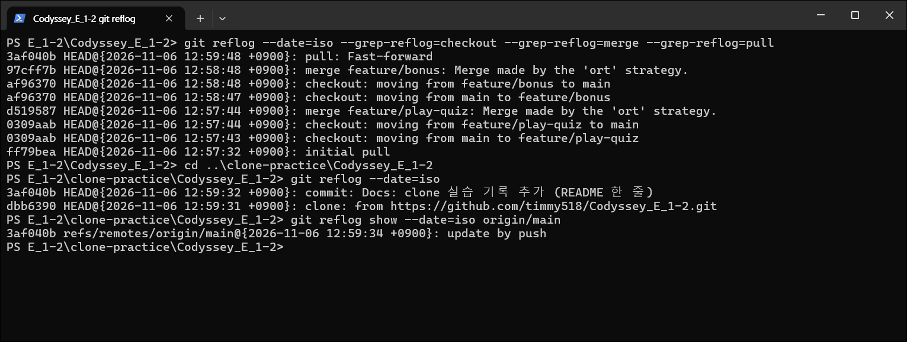

# 나만의 퀴즈 게임 — Python 콘솔 퀴즈

Codyssey 입학연수 미션 "컴퓨터에게 명령 내리는 말(파이썬) 처음 배우기" 수행 기록입니다. 터미널에서 동작하는 4지선다 퀴즈 게임을 Python으로 만들고, 퀴즈와 점수를 `state.json` 에 저장해 다시 실행해도 유지되게 했습니다. Git으로 기능 단위 커밋, 브랜치 생성·병합, clone·pull 을 기록했습니다.

- 저장소(공개): https://github.com/timmy518/Codyssey_E_1-2
- Git 기록 요약: `main` 커밋 28개(작업 커밋 25개, 병합 커밋 2개, GitHub 첫 커밋 1개 — 12장 그래프 기준). `feature/play-quiz`·`feature/bonus` 브랜치를 `--no-ff` 로 병합했고(`d519587`, `97cff7b`), 2026-11-06 12:59:31 clone → 12:59:34 clone 한 폴더에서 push → 12:59:48 원래 작업 폴더에서 pull 했습니다. 커밋 그래프·reflog 출력과 캡처는 [12장](#12-git-작업-기록)과 `docs/` 에, 전체 커밋은 [GitHub 커밋 목록](https://github.com/timmy518/Codyssey_E_1-2/commits/main)에 있습니다.
- 미션 필수 항목과 보너스 과제(선택) 외에 추가로 한 작업은 **(보충)** 으로 표시했습니다.

## 목차

1. [프로젝트 개요](#1-프로젝트-개요)
2. [퀴즈 주제와 선정 이유](#2-퀴즈-주제와-선정-이유)
3. [실행 환경](#3-실행-환경)
4. [실행 방법](#4-실행-방법)
5. [기능 목록](#5-기능-목록)
6. [파일 구조](#6-파일-구조)
7. [데이터 파일 설명 (state.json)](#7-데이터-파일-설명-statejson)
8. [수행 항목 체크리스트](#8-수행-항목-체크리스트)
9. [검증 방법 (보충)](#9-검증-방법-보충)
10. [트러블슈팅](#10-트러블슈팅)
11. [개념 정리 (과제 목표)](#11-개념-정리-과제-목표)
12. [Git 작업 기록](#12-git-작업-기록)
13. [실행 화면](#13-실행-화면)

---

## 1. 프로젝트 개요

- 메뉴에서 번호를 골라 퀴즈 풀기, 퀴즈 추가, 퀴즈 목록, 점수 확인, 퀴즈 삭제를 할 수 있는 콘솔 프로그램입니다.
- 클래스 두 개로 역할을 나눴습니다. `Quiz` 는 퀴즈 한 문제, `QuizGame` 은 메뉴·게임 진행·입력 처리·저장/불러오기를 맡습니다.
- 퀴즈 목록, 최고 점수, 게임 기록을 프로젝트 루트의 `state.json` 에 UTF-8 로 저장합니다.
- Python 3.10 이상, 외부 라이브러리 없이 표준 라이브러리만 사용합니다.

## 2. 퀴즈 주제와 선정 이유

**주제: Python & Git 기초**

이번 과정에서 배우는 자료형, 반복문, 클래스, 예외 처리, JSON, Git 명령어를 퀴즈로 만들었습니다. 문제를 직접 만들면서 개념을 한 번 더 정리하고, 게임을 할 때마다 배운 내용을 복습할 수 있습니다.

### 퀴즈 바꾸는 방법

기본 퀴즈는 `default_quizzes.py` 한 파일에 모여 있습니다.

1. `get_default_quizzes()` 안의 `Quiz(...)` 목록을 원하는 문제로 바꿉니다. (5개 이상, 선택지 4개, 정답 번호 1~4, 힌트)
2. `state.json` 을 지우고 다시 실행하면 바꾼 퀴즈로 시작합니다. 이때 저장해 둔 퀴즈·최고 점수·게임 기록도 함께 지워집니다. (`state.json` 이 있으면 저장된 퀴즈를 그대로 불러옵니다)
3. 이 README 의 '퀴즈 주제와 선정 이유'도 함께 고칩니다. 퀴즈 수가 바뀌면 6·7·8·11장의 '10개' 표기도 고치고, 5·7장의 실행 예시는 다시 실행해 바꿉니다.
4. `python -m unittest discover -s tests -v` 로 확인합니다. 테스트는 기본 퀴즈의 개수·정답·문제 문구를 `get_default_quizzes()` 에서 읽어 쓰므로, 1번 조건을 지키면 퀴즈 수나 주제가 바뀌어도 테스트를 고치지 않고 통과합니다. 단, 선택지는 숫자도 `"4"` 처럼 따옴표로 감싼 글자로 적고(숫자 그대로 적으면 다시 실행할 때 손상된 파일로 처리됩니다), 이모지나 별·하트 같은 그림 기호는 쓰지 않습니다(`test_main.py` 가 화면 출력과 소스를 검사합니다).

## 3. 실행 환경

- **OS**: Windows 11 Home Single Language 25H2 (빌드 10.0.26200.9711) — 확인: `(Get-CimInstance Win32_OperatingSystem).Caption`
- **Python**: 3.13.17 — 확인: `python --version`
- **Git**: 2.56.0.windows.4 — 확인: `git --version`
- **터미널**: Windows Terminal 1.24.12741.0, Windows PowerShell 5.1
- **에디터**: VS Code 1.144.1 — 확인: `code --version`
- **Git 설정**: `user.name=timmy518`, `init.defaultbranch=main` — 확인: `git config --list`

## 4. 실행 방법

Python 3.10 이상이 필요합니다.

```bash
python --version
git clone https://github.com/timmy518/Codyssey_E_1-2.git
cd Codyssey_E_1-2
python main.py
```

(보충) 테스트 실행:

```bash
python -m unittest discover -s tests -v
```

## 5. 기능 목록

| 메뉴 | 기능 |
| --- | --- |
| 1. 퀴즈 풀기 | 풀 문제 수를 고르면 퀴즈를 랜덤 순서로 출제합니다. 정답 번호(1-4)를 입력하면 정답/오답을 알려 주고, 모두 풀면 결과와 점수를 보여 줍니다. 퀴즈가 없으면 안내합니다. |
| 2. 퀴즈 추가 | 문제, 선택지 4개, 정답 번호(1-4), 힌트(없으면 Enter)를 입력받아 등록하고 저장합니다. |
| 3. 퀴즈 목록 | 등록된 퀴즈의 문제 목록을 보여 줍니다. 퀴즈가 없으면 안내합니다. |
| 4. 점수 확인 | 최고 점수와 게임 기록을 보여 줍니다. 아직 퀴즈를 풀지 않았으면 안내합니다. |
| 5. 퀴즈 삭제 | 목록에서 번호를 골라 퀴즈를 삭제하고 저장합니다. |
| 6. 종료 | 데이터를 저장하고 종료합니다. |

- **점수**: 맞힌 문제는 1점, 힌트를 보고 맞힌 문제는 0.5점입니다. `얻은 점수 ÷ 푼 문제 수 × 100` (소수점 아래 버림)
- **최고 점수**: 퀴즈를 풀 때마다 최고 점수와 비교해 더 높으면 갱신하고 저장합니다.
- **입력 처리**: 앞뒤 공백을 지우고 처리합니다. 숫자가 아니거나, 범위 밖이거나, 빈 입력이면 안내 메시지를 출력하고 다시 입력받습니다.
- **`Ctrl+C` / 입력 종료**: `입력이 중단되어 프로그램을 종료합니다.` 를 출력하고 저장한 뒤 종료합니다. 저장에 성공하면 따로 문구 없이 끝나고, 실패하면 `데이터를 저장하지 못했습니다.` 가 함께 나옵니다.
- **데이터 파일**: 없으면 기본 퀴즈로 시작하고, 손상되었으면 안내 메시지를 출력한 뒤 기본 퀴즈로 복구합니다.

### 정답 입력 처리

퀴즈를 풀 때 정답 입력 칸에 무엇을 넣느냐에 따라 아래처럼 처리합니다.

| 입력 | 처리 |
| --- | --- |
| `1`~`4` (앞뒤 공백 허용) | 채점하고 `정답입니다!` 또는 `오답입니다.` 를 출력합니다. |
| `h` 또는 `H` (힌트가 있는 문제) | 힌트를 보여 주고 같은 문제의 답을 다시 묻습니다. 몇 번을 봐도 그 문제는 맞혀도 0.5점입니다. |
| `h` (힌트가 없는 문제) | 힌트 안내 없이 `정답 입력:` 으로 묻고, `h` 는 숫자가 아니므로 `잘못된 입력입니다. 1-4 사이의 숫자를 입력하세요.` 를 출력하고 다시 묻습니다. |
| `abc`, `0`, `5` | `잘못된 입력입니다. 1-4 사이의 숫자를 입력하세요.` 를 출력하고 다시 묻습니다. |
| 빈 입력 | `입력값이 없습니다. 1-4 사이의 숫자를 입력하세요.` 를 출력하고 다시 묻습니다. |
| `Ctrl+C`, 입력 종료 | 풀던 게임은 기록하지 않고, 데이터를 저장한 뒤 종료합니다. |

### 사용 예시

실제로 실행한 결과입니다. 입력한 값은 프롬프트 뒤에 적었고, 두 번째부터 반복되는 메뉴는 `(메뉴)` 로 줄였습니다.

```text
========================================
            나만의 퀴즈 게임
========================================

========================================
1. 퀴즈 풀기
2. 퀴즈 추가
3. 퀴즈 목록
4. 점수 확인
5. 퀴즈 삭제
6. 종료
========================================
선택: 1

몇 문제를 풀까요? (1-10): 2

퀴즈를 시작합니다! (총 2문제)

----------------------------------------
[문제 1]
클래스로 객체를 만들 때 자동으로 호출되어 속성을 초기화하는 메서드는?

1. __init__
2. __str__
3. __len__
4. __main__

정답 입력 (힌트: h): h
힌트: '초기화하다(initialize)'의 앞 글자를 따서 만든 이름이에요.
정답 입력 (힌트: h): 2
오답입니다.

----------------------------------------
[문제 2]
Git에서 변경된 파일을 커밋할 대상(스테이징 영역)에 올리는 명령어는?

1. git add
2. git commit
3. git push
4. git clone

정답 입력 (힌트: h): 9
잘못된 입력입니다. 1-4 사이의 숫자를 입력하세요.
정답 입력 (힌트: h): 1
정답입니다!

========================================
결과: 2문제 중 1문제 정답! (50점)
새로운 최고 점수입니다!
========================================
(메뉴)
선택: 4

최고 점수: 50점

게임 기록 (총 1회)
----------------------------------------
2026-11-10 18:58:54 | 2문제 | 50점
----------------------------------------
(메뉴)
선택: 6

게임을 종료합니다.
```

문제 1 은 힌트를 본 뒤 틀렸고, 문제 2 는 잘못된 입력(`9`) 뒤에 맞혀 1점을 받았으므로 (0 + 1) ÷ 2 × 100 = 50점입니다. 퀴즈 추가(2)·목록(3)·삭제(5)는 7장 [저장이 유지되는지 확인하기](#저장이-유지되는지-확인하기)에 실제 실행 결과가 있습니다.

메뉴에서 잘못 입력하면 아래처럼 안내하고 다시 묻습니다(실제 실행 결과).

```text
선택: abc
잘못된 입력입니다. 1-6 사이의 숫자를 입력하세요.
선택: 9
잘못된 입력입니다. 1-6 사이의 숫자를 입력하세요.
선택:
입력값이 없습니다. 1-6 사이의 숫자를 입력하세요.
선택: 6

게임을 종료합니다.
```

### 보너스 과제 (선택)

- 랜덤 출제 — `random.sample()` 로 문제를 중복 없이 랜덤 순서로 고릅니다.
- 문제 수 선택 — 풀기 전에 몇 문제를 풀지 입력합니다.
- 힌트 — `Quiz` 에 `hint` 속성이 있고, 풀이 중 `h` 를 입력하면 힌트를 봅니다. 힌트를 본 문제는 맞혀도 0.5점입니다.
- 퀴즈 삭제 — 번호로 골라 삭제하고 `state.json` 에 반영합니다.
- 점수 기록 히스토리 — 게임마다 날짜/시간, 푼 문제 수, 점수를 저장하고 점수 확인에서 보여 줍니다.

### 보충

- Python 버전 확인 — 3.10 미만에서 실행하면 안내 메시지를 출력하고 종료합니다. (`main.py`)
- 손상 파일 백업 — 손상된 `state.json` 을 기본 퀴즈로 복구하기 전에 `state.json.bak` 으로 복사해 둡니다.
- 테스트 코드 — `tests/` 폴더 ([9장](#9-검증-방법-보충))

## 6. 파일 구조

```text
.
├── main.py              # 실행 파일 (Python 버전 확인 → 게임 시작)
├── quiz.py              # Quiz 클래스: 퀴즈 한 문제 (문제 출력, 정답 확인, 저장용 변환)
├── quiz_game.py         # QuizGame 클래스: 메뉴, 퀴즈 풀기/추가/목록/삭제, 점수, 입력 처리, 저장/불러오기
├── default_quizzes.py   # 기본 퀴즈 데이터 (Quiz 인스턴스 10개)
├── tests/               # (보충) unittest 테스트
│   ├── test_quiz.py
│   ├── test_quiz_game.py
│   └── test_main.py
├── docs/
│   ├── screenshots/     # 실행 화면, Git 기록 캡처
│   └── git_records.txt  # Git 기록 텍스트 (커밋 그래프, reflog)
├── state.json           # 실행하면 생기는 데이터 파일 (.gitignore 로 제외)
├── state.json.bak       # (보충) 손상 파일 백업, 손상되었을 때만 생김 (.gitignore 로 제외)
├── .gitignore
└── README.md
```

### 클래스와 메서드 역할

| 클래스 | 메서드 | 하는 일 |
| --- | --- | --- |
| `Quiz` | `display()` | 문제 번호, 문제, 선택지를 출력 |
| `Quiz` | `is_correct()` / `has_hint()` | 입력한 번호가 정답인지 / 힌트가 있는지 확인 |
| `Quiz` | `to_dict()` / `from_dict()` | 저장용 dict 로 바꾸기 / 읽은 dict 를 검사해 `Quiz` 로 만들기 |
| `QuizGame` | `run()` | 시작점. 불러오기 → 메뉴 반복 → 종료, `Ctrl+C`·입력 종료 처리 |
| `QuizGame` | `show_title()` / `show_menu()` / `quit()` | 제목 출력 / 메뉴 출력 / 저장 후 종료 |
| `QuizGame` | `parse_number()` / `ask_number()` / `ask_text()` | 입력 검증: 숫자 변환·범위·빈 입력 검사 / 올바를 때까지 다시 묻기 / 빈 글자 검사 |
| `QuizGame` | `play()` / `ask_answer()` / `finish_game()` / `update_best_score()` | 퀴즈 풀기: 출제·채점 / 정답·힌트 입력 / 결과 출력과 기록 저장 / 최고 점수 갱신 |
| `QuizGame` | `add_quiz()` / `list_quizzes()` / `show_score()` / `delete_quiz()` | 퀴즈 추가 / 목록 / 점수 확인 / 삭제 |
| `QuizGame` | `load_data()` / `save_data()` / `backup_corrupted_file()` / `use_default_quizzes()` | 파일 입출력: 불러오기와 검사 / 저장 / 손상 파일 백업 / 기본 퀴즈로 시작 |

**이렇게 나눈 이유**: 문제 하나의 데이터와 그 데이터만 쓰는 일(출력, 정답 확인, 저장용 변환과 검사)은 `Quiz` 에 두어, 퀴즈 한 문제의 저장 형식과 검사는 `quiz.py` 안에서만 고치면 되게 했습니다. `QuizGame` 은 미션에서 정한 대로 메뉴·풀기·추가·목록·점수·저장/불러오기를 맡습니다. 한 클래스가 하는 일이 많은 대신 메서드를 입력 검증·기능·파일 입출력으로 나눠(아래 그림) 한 부분을 고쳐도 다른 부분은 그대로 둘 수 있게 했고, 저장 코드가 더 커지면 `load_data()`·`save_data()`·`backup_corrupted_file()` 을 저장만 맡는 클래스로 옮길 수 있습니다.

### 입력 검증과 파일 입출력의 경계

```text
키보드 입력 -> ask_number() / ask_answer() 는 parse_number() 로, ask_text() 는 빈 글자만 검사 (틀리면 안내 후 다시 묻기)
                    |
                    v  올바른 값만 넘어감
play() / add_quiz() / delete_quiz() 등 -> 메모리의 quizzes / best_score / history 를 바꿈
                    |
                    v  저장 시점마다
save_data() -> state.json
(시작할 때) state.json -> load_data() (형식 검사, Quiz.from_dict()) -> 메모리
```

입력 검증 메서드는 키보드 입력만, 파일 입출력 메서드는 `state.json`(백업 `state.json.bak` 포함)만 다루고, 기능 메서드는 그 사이에서 메모리의 데이터를 바꾸고 결과를 화면에 보여 줍니다. 그래서 입력 규칙을 바꿀 때는 파일 코드를, 저장 방식을 바꿀 때는 입력 코드를 건드리지 않아도 됩니다. (퀴즈 추가의 힌트는 빈 값도 허용하므로 `add_quiz()` 에서 직접 입력받습니다.)

### 요구사항이 바뀔 때 고칠 곳 (체크리스트)

요구사항이 바뀌면 해당 줄의 파일·메서드(수정 지점)를 고치고, '함께 확인할 것'을 차례로 점검합니다.

| 바뀌는 요구사항 | 고칠 파일·메서드 | 함께 확인할 것 |
| --- | --- | --- |
| 퀴즈 주제·문제 | `default_quizzes.py` 의 `get_default_quizzes()` 와 맨 위 주제 설명 | `state.json` 을 지우고 다시 실행(저장된 퀴즈·점수·기록도 지워짐). README 2장(퀴즈 바꾸는 방법, 주제와 선정 이유), 6·7·8·11장의 퀴즈 수(10개), 7장 JSON 예시, 5·7장 실행 예시(다시 실행해 바꿈). 테스트는 퀴즈 수·정답·문제 문구를 기본 퀴즈에서 읽어 쓰므로 고칠 필요 없음(조건: 5개 이상, 선택지 4개, 정답 1~4, 모든 퀴즈에 힌트 — `test_quiz.py` 가 검사. 선택지는 숫자도 글자로 적고 이모지·그림 기호는 쓰지 않음 — 다시 실행 테스트와 `test_main.py` 가 검사) |
| 메뉴 항목 추가·순서 | `quiz_game.py` 의 `QuizGame.MENU`(메뉴 이름), `run()` 의 번호별 분기(마지막 `else` 가 종료), 새 기능 메서드 | README 1장 개요·5장 기능 표와 5·7장 실행 예시, 메뉴 번호와 '1-6' 을 쓰는 테스트(`test_quiz_game.py`, `test_main.py`) |
| 선택지 개수 (4개 → 다른 수) | `quiz.py` 의 `Quiz.CHOICE_COUNT` (퀴즈 추가 때 입력받는 선택지 수, 정답 번호 범위, 불러올 때 검사가 함께 바뀜) | 기본 퀴즈의 선택지, 코드의 `4개`·`1~4` 문구(`from_dict()` 오류 문구, 독스트링), 예전 `state.json`(선택지 수가 달라 손상 파일로 처리됨), README 의 `4지선다`·`선택지 4개`·`1~4`·`1-4` 표기와 5·7장 실행 예시, 선택지 4개를 가정한 테스트(세 파일 모두) |
| 점수 계산·힌트 감점 | `quiz_game.py` 의 `QuizGame.HINT_PENALTY`, `play()` 의 점수 계산, `update_best_score()`(최고 점수 갱신 기준) | `HINT_PENALTY` 옆 주석, README 5장 점수·힌트 설명, `test_quiz_game.py` 의 점수 기대값 |
| `state.json` 에 항목 추가 (예: 퀴즈 난이도) | 퀴즈 항목: `quiz.py` 의 `__init__()`·`to_dict()`·`from_dict()`, 입력받으려면 `add_quiz()` / 전체 항목: `quiz_game.py` 의 `__init__()`·`load_data()`·`save_data()`·`use_default_quizzes()` / 게임 기록 항목: `finish_game()`·`show_score()`·`load_data()` 의 기록 검사 | 예전 파일도 읽히도록 `.get(키, 기본값)` 으로 읽기(`hint` 처럼. 꼭 있어야 하게 검사하면 예전 파일이 손상 파일로 처리됨), README 5장 기능 설명·7장 표와 예시, 저장 내용을 그대로 비교하는 테스트(`test_quiz.py`, `test_quiz_game.py`) |
| 데이터 파일 위치·이름 | `main.py` 의 `STATE_FILE` | `.gitignore`, 코드 주석과 README 의 `state.json` 표기(7장 제목을 바꾸면 목차·8장 링크도), `test_main.py` 의 위치·백업 테스트. 백업 파일 이름은 `backup_corrupted_file()` 이 `<이름>.bak` 으로 따라 바꿈 |
| 입력 검증 규칙·안내 문구 | 숫자 검사와 그 안내 문구는 `quiz_game.py` 의 `parse_number()` 한 곳(글자 입력의 빈 값 안내는 `ask_text()`). 입력받기(앞뒤 공백 제거)는 `ask_number()`·`ask_text()`·`ask_answer()`(풀이 중 `h`)와 `add_quiz()` 의 힌트 입력 | README 5장 입력 처리(규칙이 바뀌면 8장도), 안내 문구를 확인하는 테스트(`test_quiz_game.py`) |
| 저장 방식 (JSON → SQLite 등) | `quiz_game.py` 의 `load_data()`·`save_data()`·`backup_corrupted_file()` | 다른 메서드는 메모리의 `quizzes`·`best_score`·`history` 만 다뤄서 그대로 둠. 파일을 JSON 으로 직접 읽고 쓰는 테스트(`test_quiz_game.py`, `test_main.py`), README 7장·11장 |

**변경 후 확인 순서** (어느 경우든)

1. `python -m unittest discover -s tests -v` 로 테스트가 모두 `OK` 인지 확인합니다. 테스트 수가 바뀌면 9장의 '38개'도 고칩니다.
2. 직접 실행해 메뉴 6개 → 퀴즈 풀기(힌트 `h`, 잘못된 입력, 점수) → 퀴즈 추가 → 종료 → 다시 실행해 추가한 퀴즈가 남았는지 → 퀴즈 삭제 → 실행 중 `Ctrl+C` 순서로 확인합니다. ([7장 '저장이 유지되는지 확인하기'](#저장이-유지되는지-확인하기))
3. `state.json` 을 복사해 둔 뒤 내용을 `{ broken` 처럼 망가뜨리고 실행해, 복구·백업 안내가 나오는지 확인하고 복사본으로 되돌립니다.
4. 화면이나 안내 문구가 바뀌었으면 `docs/screenshots` 의 실행 화면과 5·7장의 실행 예시를 다시 실행해 바꾸고, README 의 퀴즈 수 표기를 확인합니다.

## 7. 데이터 파일 설명 (`state.json`)

- **경로**: 프로젝트 루트 (`main.py` 와 같은 폴더). 다른 폴더에서 실행해도 이 위치를 씁니다.
- **역할**: 퀴즈 목록, 최고 점수, 게임 기록을 UTF-8 JSON 으로 저장해 프로그램을 다시 실행해도 유지되게 합니다.
- **저장 시점**: 퀴즈 추가·삭제, 퀴즈 풀기 완료, 종료(`Ctrl+C` 포함), 손상된 파일 복구
- **이렇게 정한 이유**: 경로를 실행한 폴더가 아니라 `main.py` 위치로 정해, 다른 폴더에서 실행해도 `state.json` 이 그 폴더에 새로 생기지 않고 항상 같은 파일을 쓰게 했습니다. 읽고 쓸 때 모두 `encoding="utf-8"` 을 지정하고 `ensure_ascii=False` 로 저장해, 컴퓨터마다 다른 기본 인코딩(한국어 Windows 는 cp949)과 상관없이 같은 파일을 읽을 수 있고 파일을 열어도 한글이 그대로 보입니다. 바뀔 때마다 바로 저장하므로 프로그램이 갑자기 꺼져도(저장하는 도중이 아니라면) 마지막으로 저장한 내용까지는 남고, 대신 저장할 때마다 파일 전체를 다시 씁니다(아래 'JSON 저장 방식의 한계').
- **손상되었을 때**: 안내 메시지 → (보충) `state.json.bak` 으로 백업 → 기본 퀴즈로 복구해 저장 (백업은 하나만 두므로 다시 손상되면 덮어쓰고, 백업에 실패해도 기본 퀴즈로 복구합니다). 백업을 여러 개 남기려면 `backup_corrupted_file()` 에서 백업 파일 이름에 날짜·시간을 붙이고, `.gitignore` 에도 그 이름 형식(예: `state.json.*.bak`)을 추가하면 됩니다.
- **백업에서 되살리려면**: 프로그램을 끈 뒤 `state.json.bak` 을 열어 깨진 부분을 고치고, 지금의 `state.json` 을 지운 다음 `state.json.bak` 의 이름을 `state.json` 으로 바꿔 실행합니다(복구 뒤에 새로 저장한 퀴즈나 점수는 이때 사라집니다). 읽기 오류(`OSError`, 예: 권한 문제) 때는 백업하지 않고 기본 퀴즈로 시작하며, 이후 저장(종료 포함)이 성공하면 원래 파일을 덮어씁니다. `데이터 파일을 읽을 수 없어 기본 퀴즈로 시작합니다.` 가 나오면 먼저 `state.json` 을 다른 곳에 복사해 둡니다.
- **저장에 실패하면**: `데이터를 저장하지 못했습니다.` 를 출력하고 오류 화면 없이 하던 일을 계속합니다(종료 중이었다면 그대로 종료). 이 문구가 나오면 폴더 쓰기 권한, 디스크 공간, 다른 프로그램이 `state.json` 을 열고 있는지 확인합니다. 따로 다시 시도하는 기능은 없지만, 원인을 해결한 뒤 퀴즈 추가·삭제나 종료(6번)처럼 저장하는 동작을 하면 그때 메모리에 있는 전체 데이터를 다시 저장합니다.
- **처음부터 다시 시작하려면**: `state.json` 을 지우고 실행합니다. 기본 퀴즈로 시작하고, 저장해 둔 퀴즈·최고 점수·기록은 사라집니다.

| 키 | 타입 | 설명 |
| --- | --- | --- |
| `quizzes` | list | 퀴즈 목록 |
| `quizzes[].question` | str | 문제 |
| `quizzes[].choices` | list[str] | 선택지 4개 |
| `quizzes[].answer` | int | 정답 번호 (1~4) |
| `quizzes[].hint` | str | 힌트 (없으면 `""`) |
| `best_score` | int 또는 null | 최고 점수 (아직 풀지 않았으면 `null`) |
| `history` | list | 게임 기록 |
| `history[].played_at` | str | 게임한 날짜/시간 (`YYYY-MM-DD HH:MM:SS`) |
| `history[].total` | int | 푼 문제 수 |
| `history[].score` | int | 점수 |

```json
{
  "quizzes": [
    {
      "question": "Python에서 x = 10 일 때, type(x)의 결과로 알맞은 자료형은?",
      "choices": ["str", "int", "float", "bool"],
      "answer": 2,
      "hint": "소수점이 없는 '정수(integer)'를 뜻하는 단어의 줄임말이에요."
    }
  ],
  "best_score": 80,
  "history": [
    {"played_at": "2026-11-04 21:10:00", "total": 5, "score": 80}
  ]
}
```

**구조를 이렇게 나눈 이유**: 퀴즈 하나를 dict 하나로 두면 `Quiz` 객체와 1:1 로 바꿀 수 있습니다(`to_dict()` / `from_dict()`). 퀴즈 목록·최고 점수·기록을 최상위 키로 나눠 두면 키 이름으로 바로 꺼내 쓰고, 파일에는 새 항목을 키 하나로 덧붙일 수 있습니다(고칠 코드는 6장 체크리스트). 실제로 `hint` 와 `history` 는 나중에 더한 항목이라 `get(키, 기본값)` 으로 읽으므로, 미션 예시처럼 `quizzes`·`best_score` 만 있는 파일도 그대로 읽힙니다. `best_score` 의 처음 값을 0 이 아니라 `null` 로 둔 것은 0점을 받은 경우와 아직 풀지 않은 경우를 구분하기 위해서입니다(점수 확인의 '아직 퀴즈를 풀지 않았습니다' 안내).

### 불러오기 흐름 (`load_data()`)

```text
load_data()
├─ 파일이 있고 형식이 맞음 → 불러오고 "저장된 데이터를 불러왔습니다. (퀴즈 N개, 최고점수 ...)" 출력
├─ 파일 없음 (FileNotFoundError, 첫 실행) → 안내 없이 기본 퀴즈로 시작
├─ 형식 오류 (ValueError, KeyError, TypeError, RecursionError) → 안내 → state.json.bak 백업 → 기본 퀴즈로 복구해 저장
└─ 읽기 오류 (OSError, 예: 권한 문제) → 안내 후 기본 퀴즈로 시작 (백업하지 않음)
```

형식 검사는 세 곳에서 합니다: `json.load()`(JSON 문법), `load_data()`(퀴즈 목록이 list 인지, 최고 점수·기록의 타입), `Quiz.from_dict()`(퀴즈마다 문제, 선택지 4개, 정답 1~4, 힌트). 어느 경우든 끝나면 불러오기를 마쳤다고 표시하고(`is_loaded`), 표시하기 전에 `Ctrl+C` 로 끝나면 저장하지 않아서 빈 데이터로 파일을 덮어쓰지 않습니다.

### 저장이 유지되는지 확인하기

퀴즈를 추가하거나 삭제하고 종료한 뒤 다시 실행하면, `state.json` 에서 그 상태를 다시 불러옵니다. 실제로 실행한 결과입니다. 입력한 값은 프롬프트 뒤에 적었고, `#` 줄은 설명입니다. 실행할 때마다 처음 나오는 제목과 반복되는 메뉴·목록은 `(메뉴)`·`(퀴즈 목록)`·`...` 으로 줄였습니다.

```text
# 1) 실행 → 2. 퀴즈 추가 → 6. 종료
(메뉴)
선택: 2

새로운 퀴즈를 추가합니다.
문제를 입력하세요: 파이썬 파일의 확장자는?
선택지 1: .py
선택지 2: .java
선택지 3: .txt
선택지 4: .exe
정답 번호 (1-4): 1
힌트 (없으면 Enter):

퀴즈가 추가되었습니다!
(메뉴)
선택: 6

게임을 종료합니다.

# 2) 다시 실행 → 저장된 퀴즈 11개를 불러옴 → 3. 퀴즈 목록 → 5. 퀴즈 삭제 → 6. 종료
저장된 데이터를 불러왔습니다. (퀴즈 11개, 최고점수 없음)
(메뉴)
선택: 3

등록된 퀴즈 목록 (총 11개)
...
[10] 새 브랜치를 만들면서 동시에 그 브랜치로 이동하는 Git 명령어는?
[11] 파이썬 파일의 확장자는?
----------------------------------------
(메뉴)
선택: 5
(퀴즈 목록)

삭제할 퀴즈 번호 (1-11): 11

퀴즈를 삭제했습니다: 파이썬 파일의 확장자는?
(메뉴)
선택: 6

게임을 종료합니다.

# 3) 다시 실행 → 삭제도 반영되어 10개
저장된 데이터를 불러왔습니다. (퀴즈 10개, 최고점수 없음)
...
```

최고 점수와 게임 기록도 같은 방식으로 유지됩니다. 5장 [사용 예시](#사용-예시)를 마친 뒤 다시 실행해 점수 확인(4)을 고른 결과입니다.

```text
저장된 데이터를 불러왔습니다. (퀴즈 10개, 최고점수 50점)
(메뉴)
선택: 4

최고 점수: 50점

게임 기록 (총 1회)
----------------------------------------
2026-11-10 18:58:54 | 2문제 | 50점
----------------------------------------
```

손상 파일 처리도 같은 방식으로 확인할 수 있습니다. `state.json` 내용을 `{ broken` 으로 바꾸고 실행하면 아래처럼 나오고, 깨진 파일은 `state.json.bak` 으로 남습니다.

```text
데이터 파일이 손상되어 기본 퀴즈 데이터로 복구합니다.
손상된 파일은 state.json.bak 으로 백업했습니다.
```

### JSON 저장 방식의 한계

지금처럼 퀴즈 10개 안팎에 게임 기록 몇 건이면(파일 약 3~4 KB) 저장과 불러오기가 금방 끝나지만, 모든 데이터를 `state.json` 하나에 JSON 으로 통째로 저장하는 방식에는 아래 한계가 있습니다. 성능·메모리 문제는 데이터가 많아질수록 커지고, 동시 실행·저장 중 중단 문제는 데이터 크기와 상관없이 생길 수 있습니다.

- **성능** — JSON 파일은 바뀐 부분만 고쳐 쓰기 어려워서, 일부만 바뀌어도 저장할 때마다 전체 데이터를 JSON 으로 바꿔 파일을 처음부터 다시 씁니다(`save_data()`). 위 '저장 시점'마다 이렇게 하므로 데이터가 많을수록 저장 시간이 길어집니다.
- **메모리** — 시작할 때 `load_data()` 가 파일 전체를 한 번에 읽어(`json.load()`) 모든 퀴즈와 게임 기록을 메모리에 올려 둡니다. 게임 기록(`history`)은 퀴즈를 끝까지 풀 때마다 한 건씩 늘고 지우는 기능이 없어서, 오래 쓸수록 파일 크기와 메모리 사용량이 계속 커집니다.
- **동시 실행** — 프로그램을 두 개 동시에 실행하면 각자 시작할 때 읽은 데이터를 들고 있다가 전체를 저장하므로, 나중에 저장한 쪽(종료할 때의 저장 포함)이 다른 쪽의 변경을 덮어씁니다.
- **저장 중 중단** — `"w"` 모드는 파일을 먼저 비운 뒤 쓰기 때문에, 쓰는 도중 오류가 나거나 프로그램이 강제로 꺼지면 파일이 비어 있거나 일부만 쓰인 채 남을 수 있습니다. 그러면 다음 실행 때 손상 파일로 처리되어, 저장해 둔 퀴즈·최고 점수·기록 대신 기본 퀴즈로 시작합니다(깨진 파일은 `state.json.bak` 으로 백업).

이런 한계가 문제가 되면 아래 대안을 검토합니다.

- **SQLite (DB)** — 표준 라이브러리 `sqlite3` 로 쓸 수 있는 파일 데이터베이스입니다. 필요한 행만 읽고 고치므로 전체를 다시 쓰거나 메모리에 다 올리지 않아도 되고, 트랜잭션 단위로 저장해서 저장 도중 꺼져도 파일이 깨지지 않습니다(저장 전 상태로 돌아감). 여러 프로그램이 함께 쓰면 잠금으로 한 번에 하나씩 쓰게 하지만, 서로 덮어쓰지 않으려면 바뀐 행만 그때그때 저장해야 합니다.
- **JSON Lines (NDJSON)** — 게임 기록처럼 쌓이기만 하는 데이터는 한 줄에 기록 하나씩 파일 끝에 덧붙이면(`"a"` 모드) 전체를 다시 쓰지 않아도 됩니다. 읽을 때도 한 줄씩 처리할 수 있고, 덧붙이는 도중 꺼져도 마지막 줄만 깨집니다.
- **임시 파일에 쓴 뒤 바꿔치기** — 같은 폴더의 임시 파일에 새 내용을 다 쓴 다음 `os.replace()` 로 `state.json` 을 바꾸면, 저장 도중 프로그램이 꺼져도 `state.json` 은 이전 내용이나 새 내용 중 하나로 온전히 남습니다. 동시 실행 문제는 해결되지 않습니다.

상황에 따라 고르면 다음과 같습니다.

| 상황 | 알맞은 저장 방식 |
| --- | --- |
| 데이터가 작고(지금은 약 3~4 KB) 한 번에 한 프로그램만 실행 — 이 프로젝트 | JSON 파일 하나 (`state.json`) |
| 저장 도중 꺼져도 파일이 깨지지 않아야 함 | JSON 그대로, 임시 파일에 쓴 뒤 `os.replace()` |
| 게임 기록처럼 계속 쌓이는 데이터가 많음 | 기록만 JSON Lines 로 덧붙이기 |
| 데이터가 크거나, 일부만 찾아 고쳐야 하거나, 여러 프로그램이 함께 씀 | SQLite 같은 데이터베이스 |

다른 방식으로 바꿀 때는 기존 `state.json` 을 한 번 읽어 새 형식으로 옮기는 변환을 먼저 하고, `quiz_game.py` 의 `load_data()`·`save_data()`·`backup_corrupted_file()` 을 바꿉니다. 이 세 메서드만 바꾸면 저장할 때마다 전체 데이터를 넘기는 구조는 그대로이므로, 바뀐 부분만 저장하는 장점까지 살리려면 `add_quiz()`·`delete_quiz()`·`finish_game()` 도 바뀐 것만 저장하도록 고칩니다. 파일 이름이 바뀌면 `main.py` 의 `STATE_FILE` 과 `.gitignore`, 파일을 직접 읽고 쓰는 테스트도 함께 고칩니다([6장 체크리스트](#요구사항이-바뀔-때-고칠-곳-체크리스트)).

## 8. 수행 항목 체크리스트

- [x] 메뉴 — 실행하면 메뉴 출력, 번호로 기능 선택, 종료 기능, 잘못된 입력 처리 → [5장](#5-기능-목록)
- [x] 공통 입력/예외 처리 — 앞뒤 공백 제거, 숫자가 아님·범위 밖·빈 입력은 안내 후 재입력, `Ctrl+C`·입력 종료 시 저장 후 안전하게 종료, 데이터 파일이 없거나 손상되어도 실행
- [x] `Quiz` 클래스 — 문제·선택지 4개·정답 번호(1~4) 속성, 출력(`display`)·정답 확인(`is_correct`) 메서드
- [x] 기본 퀴즈 데이터 — 주제 퀴즈 10개를 `Quiz` 인스턴스로 작성 (`default_quizzes.py`)
- [x] 퀴즈 풀기 — `feature/play-quiz` 브랜치에서 작업 후 `main` 에 병합 → [12장](#12-git-작업-기록)
- [x] 퀴즈 추가 · 퀴즈 목록 · 점수 확인 — 입력 검증, 파일 저장, 퀴즈가 없거나 아직 풀지 않은 경우 처리
- [x] `QuizGame` 클래스 — 퀴즈 목록·최고 점수 속성, 메뉴·풀기·추가·목록·점수·저장/불러오기 메서드
- [x] `state.json` 저장/불러오기 — 프로젝트 루트, UTF-8, `quizzes`·`best_score` 포함 → [7장](#7-데이터-파일-설명-statejson)
- [x] README — 개요, 주제 선정 이유, 실행 방법, 기능 목록, 파일 구조, 데이터 파일 설명
- [x] Git — 의미 있는 커밋 10개 이상, 브랜치 생성·병합(`checkout`, `merge`), `clone`·`pull` 사용 → [12장](#12-git-작업-기록) (커밋 그래프·reflog 출력과 캡처)
- [x] 보너스 — 랜덤 출제, 문제 수 선택, 힌트, 퀴즈 삭제, 점수 기록 히스토리
- [x] (보충) Python 버전 확인, 손상 파일 백업, 테스트 코드

## 9. 검증 방법 (보충)

`tests/` 의 unittest 테스트 38개로 기능과 예외 처리를 확인했습니다. 실행 결과: `Ran 38 tests ... OK`

```bash
python -m unittest discover -s tests -v
```

| 파일 | 확인하는 것 |
| --- | --- |
| `test_quiz.py` | `Quiz` 저장용 변환(`to_dict`/`from_dict`), 잘못된 퀴즈 데이터 거부, 정답 확인, 기본 퀴즈(5개 이상, `Quiz` 인스턴스, 선택지 4개, 정답 1~4, 힌트) |
| `test_quiz_game.py` | 숫자·글자 입력 검증, 메뉴, 퀴즈 풀기(문제 수 선택, 랜덤, 힌트 점수, 소수점 버림), 최고 점수 갱신, 추가·목록·점수·삭제, 다시 실행 후 데이터 유지, 손상 파일 복구와 백업, 저장 실패 안내, `Ctrl+C`·입력 종료 |
| `test_main.py` | `main.py` 를 실제로 실행: 입력이 끊겨도 오류 없이 종료, `state.json` 위치, 전체 흐름과 재실행, 손상 파일 백업, Python 버전 확인, 출력에 이모지 없음 |

테스트는 `input()` 을 정해 둔 입력으로 바꿔 실행하고, 데이터 파일은 임시 폴더에 만들어 실제 `state.json` 을 건드리지 않습니다.

## 10. 트러블슈팅

### 10-1. `python` 을 실행하면 Microsoft Store 안내만 나옴

- **증상**: `Python was not found; run without arguments to install from the Microsoft Store ...`
- **원인**: Python이 설치되지 않은 상태에서 Windows의 앱 실행 별칭(`WindowsApps\python.exe`)이 먼저 실행됨
- **해결**: `winget install --id Python.Python.3.13` 으로 설치하고, 새 터미널에서 `python --version` 으로 3.13.17 확인

### 10-2. `git clone` 이 `Filename too long` 으로 실패

- **증상**: clone 실습 중 `unable to open loose object ...: Filename too long`
- **원인**: Windows의 경로 길이 제한(260자). 복제할 폴더 경로가 길어서 `.git` 안의 파일을 만들지 못함
- **해결**: 그 복제본에만 긴 경로를 허용해서 clone — `git -c core.longpaths=true clone --config core.longpaths=true <저장소 URL>`

### 10-3. `git push` 가 `remote: Internal Server Error` 로 거절됨

- **증상**: `! [remote rejected] main -> main (Internal Server Error)`
- **원인**: GitHub 쪽 일시 오류. 같은 시각에 다른 브랜치 push 는 성공해 인증과 네트워크는 정상이었음
- **해결**: 잠시 후 같은 명령으로 다시 push 해서 성공

### 10-4. 커밋할 때 `LF will be replaced by CRLF` 경고

- **원인**: Windows용 Git의 기본 설정 `core.autocrlf=true`. 저장소에는 LF 로 저장하고 작업 폴더에서는 CRLF 로 바꿔 쓴다는 안내
- **해결**: 동작에는 문제가 없어 그대로 둠 (커밋된 파일은 LF)

## 11. 개념 정리 (과제 목표)

### Python 기초

- **변수** — 값을 이름에 담아 두고 다시 쓰는 것입니다. 맞힌 개수를 세는 `correct_count`, 최고 점수를 담는 `self.best_score` 처럼 계속 바뀌는 값을 기억하는 데 씁니다.
- **int, str, bool, list, dict** — 정수(`answer`, `score`), 문자열(`question`, `hint`), 참/거짓(`is_correct()` 의 결과), 순서가 있는 목록(`choices`, `quizzes`, `history`), 키와 값의 쌍(`to_dict()` 의 결과, 게임 기록 한 건)입니다.
- **if / elif / else** — 조건에 따라 다른 일을 합니다. `run()` 에서 입력한 메뉴 번호에 맞는 기능을 고릅니다.
- **for 와 while** — `for` 는 정해진 목록을 차례로 돌 때(고른 퀴즈 출제, 선택지 출력), `while` 은 언제 끝날지 모를 때(올바른 입력이 들어올 때까지 다시 묻기, 종료를 고를 때까지 메뉴 반복) 씁니다.
- **함수, 매개변수, 반환값** — `parse_number(text, min_value, max_value)` 는 입력 글자와 범위를 받아 올바르면 숫자, 아니면 `None` 을 돌려줍니다.

### 클래스와 객체

- **클래스** — 관련된 데이터와 기능을 묶은 설계도입니다. `Quiz` 로 문제 하나를, `QuizGame` 으로 게임 전체를 표현해 역할을 나눴습니다. `Quiz(...)` 로 만든 퀴즈 10개가 객체입니다.
- **함수만 쓸 때와 비교** — 함수만으로 만들면 퀴즈 목록·최고 점수·기록을 전역 변수로 두거나 함수마다 매개변수로 넘겨야 해서, 어느 함수가 데이터를 바꾸는지 따라가기 어렵습니다. 클래스로 묶으면 데이터(속성)와 그 데이터를 다루는 기능(메서드)이 한곳에 있고, 테스트에서 `QuizGame(임시 경로)` 처럼 객체를 따로 만들어 실제 `state.json` 을 건드리지 않고 확인할 수 있습니다. 퀴즈도 dict 로만 두면 정답 확인·형식 검사 코드가 쓰는 곳마다 흩어지기 쉽지만, 클래스로 두면 `is_correct()`·`from_dict()` 한 곳에 모입니다. 대신 이 정도 크기의 프로그램에서는 함수만 쓸 때보다 코드가 조금 길어집니다.
- **`__init__` 과 `self`** — `__init__` 은 객체를 만들 때 자동으로 실행되어 속성을 준비합니다. `self` 는 메서드를 호출한 그 객체 자신이라, `self.question` 은 "이 퀴즈의 문제"입니다.
- **속성과 메서드** — 속성은 객체가 가진 데이터(`question`, `choices`, `answer`, `hint` / `quizzes`, `best_score`, `history`), 메서드는 객체가 하는 일(`display()`, `is_correct()` / `play()`, `save_data()`)입니다.

### 파일 입출력

- **파일 열기·읽기·쓰기** — `with open(경로, "r" 또는 "w", encoding="utf-8") as file:` 로 열고 읽거나 씁니다. `with` 블록이 끝나면 파일이 자동으로 닫힙니다.
- **JSON** — dict·list 를 사람이 읽을 수 있는 텍스트로 저장하는 형식이라, 퀴즈 목록처럼 구조가 있는 데이터를 저장하고 다시 불러오기 좋습니다. `json.load()` 로 읽고 `json.dump()` 로 씁니다. 텍스트나 CSV 로 저장하면 선택지 4개 같은 목록을 나눠 적고 다시 합치는 코드가 따로 필요하지만, JSON 은 dict·list 구조를 그대로 저장하고 표준 라이브러리 `json` 만으로 읽고 쓸 수 있어 이런 데이터에 알맞습니다. 다만 저장할 때마다 파일 전체를 다시 쓰고 시작할 때 데이터 전체를 메모리에 올리므로, 데이터가 많아지면 저장이 느려지고 메모리를 많이 씁니다. ([7장](#json-저장-방식의-한계))
- **try / except** — 오류가 나도 프로그램이 멈추지 않게 처리합니다. 파일이 없으면(`FileNotFoundError`) 기본 퀴즈로 시작하고, JSON 형식 오류(`ValueError`)나 항목 없음(`KeyError`)은 안내 후 기본 퀴즈로 복구하며, `Ctrl+C`(`KeyboardInterrupt`)와 입력 종료(`EOFError`)는 저장 후 종료합니다. except 는 위에서부터 차례로 맞춰 보므로 `OSError` 의 한 종류인 `FileNotFoundError` 를 먼저 두어 첫 실행을 읽기 오류와 구분하고, 숫자 입력은 `parse_number()` 에서 `int()` 변환 실패(`ValueError`)를 잡아 다시 묻습니다. 오류는 종류를 정해 잡으므로, 그 밖의 오류(코드 실수 등)는 숨겨지지 않고 오류 화면으로 드러납니다.

### Git 기초

- **Git** — 파일의 변경 이력을 기록하는 도구입니다. 언제 무엇을 바꿨는지 남기고, 브랜치로 작업을 나눴다가 합칠 수 있습니다. 문제가 생기면 이전 커밋과 비교하거나 그 상태로 되돌릴 수 있습니다. GitHub는 그 저장소를 인터넷에 올려 공유하는 원격 저장소입니다.

| 명령어 | 하는 일 |
| --- | --- |
| `git init` | 현재 폴더를 Git 저장소로 만든다 |
| `git add` | 변경된 파일을 커밋할 대상(스테이징 영역)에 올린다 |
| `git commit` | 스테이징된 변경을 하나의 기록(커밋)으로 남긴다 |
| `git push` | 로컬 커밋을 원격 저장소(GitHub)에 올린다 |
| `git pull` | 원격 저장소의 새 커밋을 가져와 현재 브랜치에 합친다 |
| `git checkout` | 브랜치를 만들거나(`-b`) 다른 브랜치로 이동한다 |
| `git clone` | 원격 저장소 전체를 새 폴더에 복제한다 |
| `git merge` | 다른 브랜치의 작업을 현재 브랜치에 합친다 |

## 12. Git 작업 기록

### 커밋 규칙

- 커밋은 기능 하나 단위로 나눴습니다. (입력 검증 → 메뉴 → Quiz → 기본 데이터 → 풀기 → 추가 → 목록 → 점수 → 구조 정리 → 저장 → 보너스 → 보충 → 테스트 → README)
- 커밋 메시지는 `종류: 변경 요약` 형식이고, 본문에 바뀐 내용을 적었습니다. (`Feat` 기능, `Refactor` 구조 개선, `Test` 테스트, `Docs` 문서, `Chore` 설정, `Merge` 브랜치 병합)
- 이 저장소는 2026-11-06 에 새로 만들면서, 2026-11-04 에 완성한 코드를 위 순서대로 나눠 다시 커밋했습니다. 그래서 초기 설정부터 clone 실습까지의 커밋 시각이 2026-11-06 몇 분 안에 모여 있습니다. 13장 실행 화면의 게임 기록(2026-11-04)과 10-3 의 push 오류는 그 전 저장소에서 작업할 때 있었던 일입니다.

실제 커밋 메시지 예시입니다(기능·구조 개선·테스트·병합 커밋, 출력 그대로).

```text
$ git show -s --format=%B 2fe33a5
Feat: 퀴즈 풀기 기능 구현

- 퀴즈를 하나씩 출제하고 정답 번호(1-4)를 입력받아 정답/오답 표시
- 모두 풀면 맞힌 개수와 점수(100점 만점, 소수점 아래 버림) 출력
- 퀴즈가 없으면 안내 메시지 출력

$ git show -s --format=%B dbedb2b
Refactor: QuizGame 책임 분리 (정답 입력, 결과 처리)

- play() 안에 있던 정답 입력을 ask_answer(), 결과 출력과 최고 점수 갱신을 finish_game() 으로 분리
- 동작은 그대로 유지

$ git show -s --format=%B 133bb0b
Test: unittest 테스트 추가 (38개)

- test_quiz.py: Quiz 저장용 변환·잘못된 데이터 거부, 정답 확인, 기본 퀴즈
- test_quiz_game.py: 입력 검증, 메뉴, 풀기·추가·목록·점수·삭제, 저장/불러오기, 손상 파일 복구, Ctrl+C·입력 종료
- test_main.py: main.py 실제 실행 (전체 흐름, state.json 위치, 버전 확인)

$ git show -s --format=%B d519587
Merge: 퀴즈 풀기 기능 병합 (feature/play-quiz)

- 퀴즈 풀기, 랜덤 출제, 문제 수 선택
```

### 커밋 기록

README 에 이 절을 추가하기 직전(`3ccc4bf`)까지 `main` 의 커밋은 28개입니다. GitHub 웹에서 만든 첫 커밋(`Initial commit`) 1개, 작업 커밋 25개(기능·구조 개선·설정·테스트·문서), 병합 커밋 2개이고, 첫 커밋을 빼면 모두 `종류: 변경 요약` 형식입니다. 전체 목록은 [GitHub 커밋 목록](https://github.com/timmy518/Codyssey_E_1-2/commits/main)에서, 이 장의 명령 출력은 텍스트 파일 [docs/git_records.txt](docs/git_records.txt)에서도 볼 수 있습니다.

```text
$ git log --oneline --graph
* 3ccc4bf Docs: 평가 항목별 설명 보강 (사용 예시, 설계 이유, 저장 흐름)
* 09749ed Test: 기본 퀴즈 개수·내용이 바뀌어도 테스트가 통과하도록 수정
* 9a01657 Docs: JSON 저장 방식의 한계와 수정 지점 체크리스트 추가
* 9e920f7 Docs: README 설명을 실제 기록에 맞게 수정
* 3af040b Docs: clone 실습 기록 추가 (README 한 줄)
* dbb6390 Docs: 실행 화면 스크린샷 추가
* 84216e6 Docs: README 작성 (개요, 주제 선정 이유, 실행 방법, 기능, 파일 구조, state.json)
* 133bb0b Test: unittest 테스트 추가 (38개)
* 6b8d1ce Feat: (보충) 손상된 데이터 파일 백업
* 9921b08 Feat: (보충) Python 버전 확인 추가
*   97cff7b Merge: 보너스 기능 병합 (feature/bonus)
|\
| * a6c5c75 Feat: 점수 기록 히스토리 저장
| * e2dc56f Feat: 퀴즈 삭제 기능 추가
| * a809c05 Feat: 힌트 기능 추가 (힌트 사용 시 해당 문제 점수 절반)
|/
* af96370 Feat: state.json 파일 저장/불러오기 구현
* dbedb2b Refactor: QuizGame 책임 분리 (정답 입력, 결과 처리)
* 56a62bc Feat: 점수 확인 기능 구현 (최고 점수 비교·갱신)
* d0b620e Feat: 퀴즈 목록 기능 구현
* 8a3f3ee Feat: 퀴즈 추가 기능 구현
*   d519587 Merge: 퀴즈 풀기 기능 병합 (feature/play-quiz)
|\
| * 42ae0ae Feat: 랜덤 출제와 문제 수 선택 기능 추가
| * 2fe33a5 Feat: 퀴즈 풀기 기능 구현
|/
* 0309aab Feat: 기본 퀴즈 데이터 작성 (Python & Git 기초 10문제)
* 904df86 Feat: Quiz 클래스 구현
* 44c2c4f Feat: 메뉴 화면과 메뉴 선택 기능 구현
* 8e4fe8a Feat: 입력 검증 메서드 구현
* e25540b Chore: 프로젝트 초기 설정 (.gitignore, README 초안)
* ff79bea Initial commit
```

같은 시점에 터미널에서 실행한 화면입니다.



### 브랜치

퀴즈 풀기와 보너스 기능은 브랜치에서 따로 만들고, 완성된 뒤 `main` 에 병합했습니다. 나머지 커밋은 `main` 에서 바로 했습니다.

| 브랜치 | 작업 내용 | 브랜치에서 한 커밋 | `main` 에 병합한 커밋 |
| --- | --- | --- | --- |
| `feature/play-quiz` | 퀴즈 풀기, 랜덤 출제, 문제 수 선택 | `2fe33a5`, `42ae0ae` | `d519587` |
| `feature/bonus` | 힌트, 퀴즈 삭제, 점수 기록 히스토리 | `a809c05`, `e2dc56f`, `a6c5c75` | `97cff7b` |

병합할 때 `git merge --no-ff` 를 사용해 병합 기록이 `git log --oneline --graph` 에 남도록 했습니다. 대신 병합할 때마다 병합 커밋이 하나씩 더 생깁니다. 이번에는 혼자 작업해 로컬에서 바로 병합했고, 여럿이 함께 작업할 때는 같은 흐름에 GitHub 의 Pull Request 와 코드 리뷰를 더해 병합하는 방식으로 넓힐 수 있습니다.

두 브랜치는 GitHub 에도 남아 있습니다([브랜치 목록](https://github.com/timmy518/Codyssey_E_1-2/branches)). 브랜치를 만들고 오간 기록(`checkout`)과 병합 기록(`merge`)은 원래 작업 폴더의 reflog(Git 이 명령을 실행할 때 시각과 함께 자동으로 남기는 기록)에 있습니다(최근 것이 위, 캡처는 아래 'clone / pull 실습').

```text
$ git reflog --date=iso --grep-reflog=checkout --grep-reflog=merge --grep-reflog=pull
3af040b HEAD@{2026-11-06 12:59:48 +0900}: pull: Fast-forward
97cff7b HEAD@{2026-11-06 12:58:48 +0900}: merge feature/bonus: Merge made by the 'ort' strategy.
af96370 HEAD@{2026-11-06 12:58:48 +0900}: checkout: moving from feature/bonus to main
af96370 HEAD@{2026-11-06 12:58:47 +0900}: checkout: moving from main to feature/bonus
d519587 HEAD@{2026-11-06 12:57:44 +0900}: merge feature/play-quiz: Merge made by the 'ort' strategy.
0309aab HEAD@{2026-11-06 12:57:44 +0900}: checkout: moving from feature/play-quiz to main
0309aab HEAD@{2026-11-06 12:57:43 +0900}: checkout: moving from main to feature/play-quiz
ff79bea HEAD@{2026-11-06 12:57:32 +0900}: initial pull
```

두 번의 병합 모두 충돌 없이 끝났습니다. 충돌이 나면 다음 순서로 처리합니다.

1. `git status` 로 충돌한 파일을 확인합니다.
2. 파일에서 `<<<<<<<`, `=======`, `>>>>>>>` 로 표시된 부분을 원하는 내용으로 고치고 표시 줄을 지웁니다.
3. `python -m unittest discover -s tests -v` 로 테스트를 확인합니다.
4. `git add <파일>` 후 `git commit` 으로 병합을 마칩니다. 병합을 취소하려면 `git merge --abort` 를 씁니다.

### clone / pull 실습

1. 이 저장소를 다른 폴더에 `git clone` 했습니다.
2. 복제한 폴더에서 README 에 이 실습 항목(아래 한 줄 포함)을 추가하고 `commit` → `push` 했습니다.
3. 원래 작업 폴더에서 `git pull` 로 그 변경을 가져와 반영된 것을 확인했습니다.

> 이 문장은 clone 한 폴더에서 추가해 push 한 뒤, 원래 작업 폴더에서 `git pull` 로 받아 온 줄입니다.

Git 이 남긴 실행 기록입니다(reflog, 최근 것이 위). clone 한 폴더는 `dbb6390` 에서 시작해 `3af040b`(README 에 이 실습 항목 추가)를 만들어 push 했고, 원래 작업 폴더는 pull 로 `dbb6390` 에서 `3af040b` 로 Fast-forward 되었습니다.

```text
# clone 한 폴더 (E_1-2\clone-practice\Codyssey_E_1-2)
$ git reflog --date=iso
3af040b HEAD@{2026-11-06 12:59:32 +0900}: commit: Docs: clone 실습 기록 추가 (README 한 줄)
dbb6390 HEAD@{2026-11-06 12:59:31 +0900}: clone: from https://github.com/timmy518/Codyssey_E_1-2.git
$ git reflog show --date=iso origin/main
3af040b refs/remotes/origin/main@{2026-11-06 12:59:34 +0900}: update by push

# 원래 작업 폴더 (E_1-2\Codyssey_E_1-2)
$ git reflog --date=iso --grep-reflog=pull
3af040b HEAD@{2026-11-06 12:59:48 +0900}: pull: Fast-forward
ff79bea HEAD@{2026-11-06 12:57:32 +0900}: initial pull
```

아래는 2026-11-10 에 터미널에서 다시 조회한 화면입니다. 위쪽은 원래 작업 폴더에서 위 '브랜치'의 reflog 명령을, 아래쪽은 clone 한 폴더에서 위 두 명령을 실행한 결과입니다.



### Git 명령 사용 기록

미션에서 요구한 Git 기초 명령 7가지(`init`, `add`, `commit`, `push`, `pull`, `checkout`, `clone`)를 모두 썼고, 병합에 쓴 `merge` 와 함께 아래 기록으로 확인할 수 있습니다.

| 명령 | 쓴 때 | 남은 기록 |
| --- | --- | --- |
| `git init` | 작업 폴더를 처음 만들 때 | `git init` 으로 만든 빈 저장소에 `git remote add origin` 을 하고 `git pull origin main` 으로 GitHub 의 첫 커밋을 받음 (reflog 맨 아래 `initial pull`) |
| `git add`, `git commit` | 기능 하나 단위로 나눠 커밋할 때 (위 '커밋 규칙') | 위 '커밋 기록' |
| `git checkout` | 브랜치를 만들고(`-b`) `main` 과 오갈 때 | reflog 의 `checkout: moving from ...` 4줄 |
| `git merge` | 브랜치를 `main` 에 합칠 때 (`--no-ff`) | 병합 커밋 `d519587`, `97cff7b` |
| `git push` | GitHub 에 올릴 때 | GitHub 의 커밋·브랜치, `origin/main` reflog 의 `update by push` (`docs/git_records.txt`) |
| `git clone` | clone 실습 | clone 한 폴더의 reflog `clone: from https://github.com/timmy518/Codyssey_E_1-2.git` |
| `git pull` | 처음 받을 때, clone 실습 마지막 | reflog 의 `initial pull`, `pull: Fast-forward` |

## 13. 실행 화면

| 메뉴 | 퀴즈 풀기 |
| --- | --- |
|  |  |

| 퀴즈 추가 | 퀴즈 목록 |
| --- | --- |
|  |  |

| 점수 확인 |
| --- |
|  |
