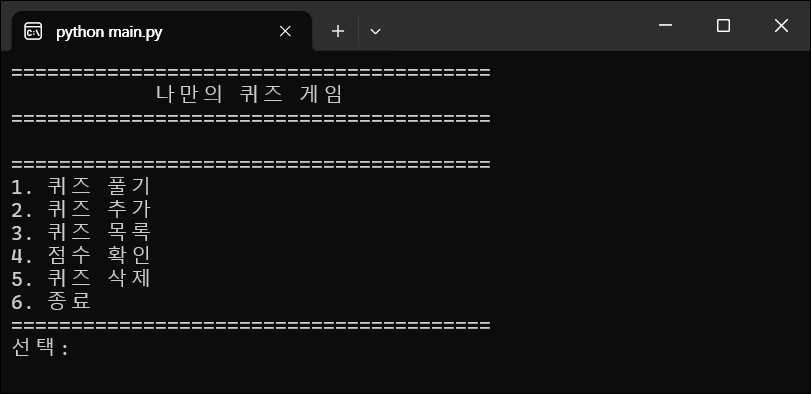
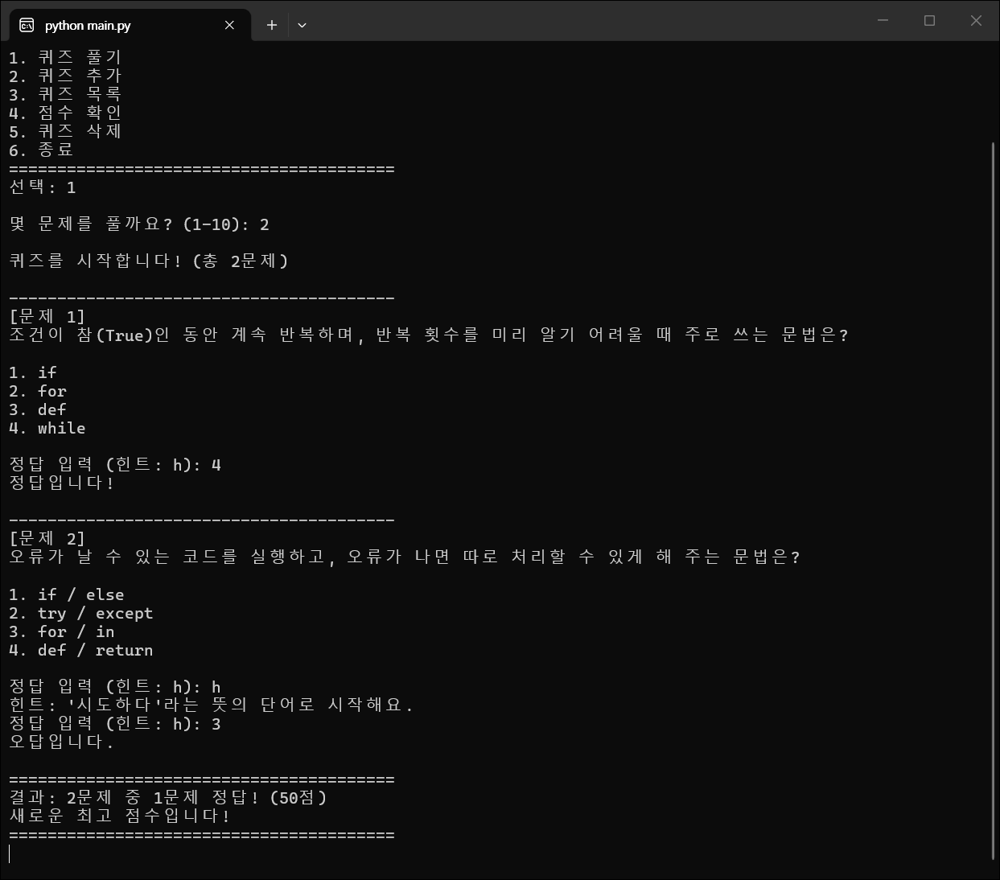
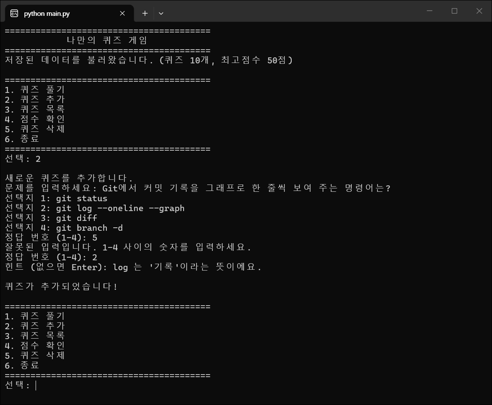
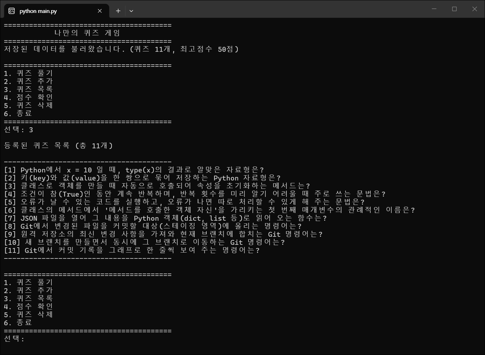
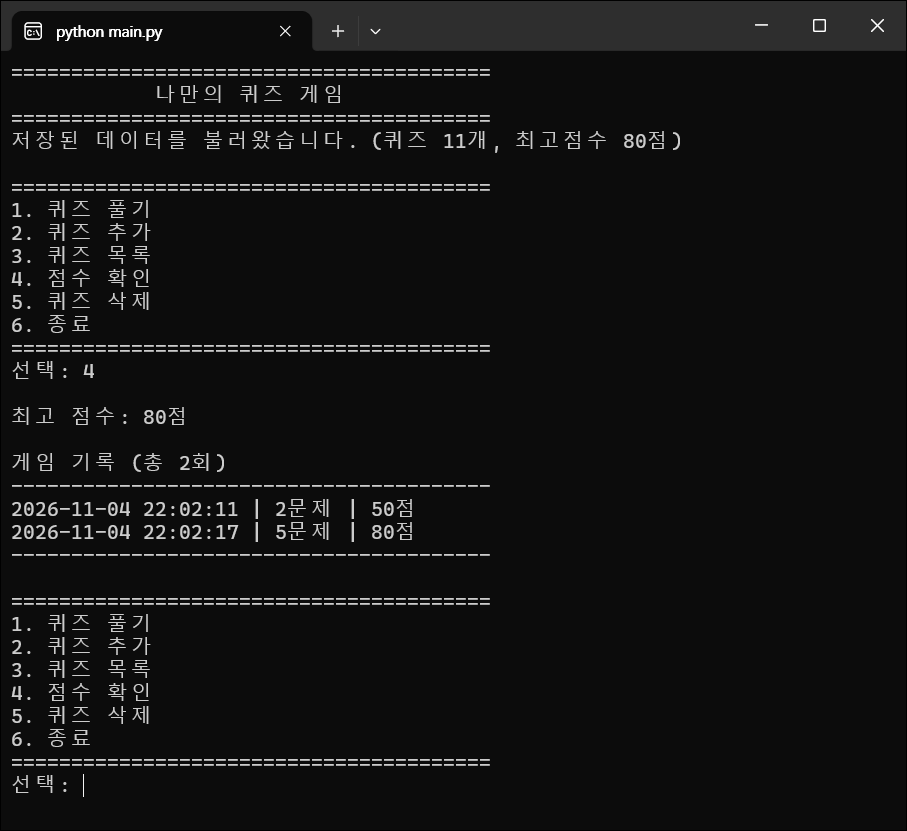

# 나만의 퀴즈 게임 — Python 콘솔 퀴즈

Codyssey 입학연수 미션 "컴퓨터에게 명령 내리는 말(파이썬) 처음 배우기" 수행 기록입니다. 터미널에서 동작하는 4지선다 퀴즈 게임을 Python으로 만들고, 퀴즈와 점수를 `state.json` 에 저장해 다시 실행해도 유지되게 했습니다. Git으로 기능 단위 커밋, 브랜치 생성·병합, clone·pull 을 기록했습니다.

- 저장소(공개): https://github.com/timmy518/Codyssey_E_1-2
- 미션 필수 항목과 보너스 과제(선택) 외에 추가로 한 작업은 **(보충)** 으로 표시했습니다.

## 목차

1. [프로젝트 개요](#1-프로젝트-개요)
2. [퀴즈 주제와 선정 이유](#2-퀴즈-주제와-선정-이유)
3. [실행 환경](#3-실행-환경)
4. [실행 방법](#4-실행-방법)
5. [기능 목록](#5-기능-목록)
6. [파일 구조](#6-파일-구조)
7. [데이터 파일 설명 (state.json)](#7-데이터-파일-설명-statejson)
8. [수행 항목 체크리스트](#8-수행-항목-체크리스트)
9. [검증 방법 (보충)](#9-검증-방법-보충)
10. [트러블슈팅](#10-트러블슈팅)
11. [개념 정리 (과제 목표)](#11-개념-정리-과제-목표)
12. [Git 작업 기록](#12-git-작업-기록)
13. [실행 화면](#13-실행-화면)

---

## 1. 프로젝트 개요

- 메뉴에서 번호를 골라 퀴즈 풀기, 퀴즈 추가, 퀴즈 목록, 점수 확인, 퀴즈 삭제를 할 수 있는 콘솔 프로그램입니다.
- 클래스 두 개로 역할을 나눴습니다. `Quiz` 는 퀴즈 한 문제, `QuizGame` 은 메뉴·게임 진행·입력 처리·저장/불러오기를 맡습니다.
- 퀴즈 목록, 최고 점수, 게임 기록을 프로젝트 루트의 `state.json` 에 UTF-8 로 저장합니다.
- Python 3.10 이상, 외부 라이브러리 없이 표준 라이브러리만 사용합니다.

## 2. 퀴즈 주제와 선정 이유

**주제: Python & Git 기초**

이번 과정에서 배우는 자료형, 반복문, 클래스, 예외 처리, JSON, Git 명령어를 퀴즈로 만들었습니다. 문제를 직접 만들면서 개념을 한 번 더 정리하고, 게임을 할 때마다 배운 내용을 복습할 수 있습니다.

### 퀴즈 바꾸는 방법

기본 퀴즈는 `default_quizzes.py` 한 파일에 모여 있습니다.

1. `get_default_quizzes()` 안의 `Quiz(...)` 목록을 원하는 문제로 바꿉니다. (5개 이상, 선택지 4개, 정답 번호 1~4, 힌트)
2. `state.json` 을 지우고 다시 실행하면 바꾼 퀴즈로 시작합니다. (`state.json` 이 있으면 저장된 퀴즈를 그대로 불러옵니다)
3. 이 README 의 '퀴즈 주제와 선정 이유'도 함께 고칩니다.

## 3. 실행 환경

- **OS**: Windows 11 Home Single Language 25H2 (빌드 10.0.26200.9711) — 확인: `(Get-CimInstance Win32_OperatingSystem).Caption`
- **Python**: 3.13.17 — 확인: `python --version`
- **Git**: 2.56.0.windows.4 — 확인: `git --version`
- **터미널**: Windows Terminal 1.24.12741.0, Windows PowerShell 5.1
- **에디터**: VS Code 1.144.1 — 확인: `code --version`
- **Git 설정**: `user.name=timmy518`, `init.defaultbranch=main` — 확인: `git config --list`

## 4. 실행 방법

Python 3.10 이상이 필요합니다.

```bash
python --version
git clone https://github.com/timmy518/Codyssey_E_1-2.git
cd Codyssey_E_1-2
python main.py
```

(보충) 테스트 실행:

```bash
python -m unittest discover -s tests -v
```

## 5. 기능 목록

| 메뉴 | 기능 |
| --- | --- |
| 1. 퀴즈 풀기 | 풀 문제 수를 고르면 퀴즈를 랜덤 순서로 출제합니다. 정답 번호(1-4)를 입력하면 정답/오답을 알려 주고, 모두 풀면 결과와 점수를 보여 줍니다. 퀴즈가 없으면 안내합니다. |
| 2. 퀴즈 추가 | 문제, 선택지 4개, 정답 번호(1-4), 힌트(없으면 Enter)를 입력받아 등록하고 저장합니다. |
| 3. 퀴즈 목록 | 등록된 퀴즈의 문제 목록을 보여 줍니다. 퀴즈가 없으면 안내합니다. |
| 4. 점수 확인 | 최고 점수와 게임 기록을 보여 줍니다. 아직 퀴즈를 풀지 않았으면 안내합니다. |
| 5. 퀴즈 삭제 | 목록에서 번호를 골라 퀴즈를 삭제하고 저장합니다. |
| 6. 종료 | 데이터를 저장하고 종료합니다. |

- **점수**: 맞힌 문제는 1점, 힌트를 보고 맞힌 문제는 0.5점입니다. `얻은 점수 ÷ 푼 문제 수 × 100` (소수점 아래 버림)
- **최고 점수**: 퀴즈를 풀 때마다 최고 점수와 비교해 더 높으면 갱신하고 저장합니다.
- **입력 처리**: 앞뒤 공백을 지우고 처리합니다. 숫자가 아니거나, 범위 밖이거나, 빈 입력이면 안내 메시지를 출력하고 다시 입력받습니다.
- **`Ctrl+C` / 입력 종료**: 안내 메시지를 출력하고 저장한 뒤 종료합니다.
- **데이터 파일**: 없으면 기본 퀴즈로 시작하고, 손상되었으면 안내 메시지를 출력한 뒤 기본 퀴즈로 복구합니다.

### 보너스 과제 (선택)

- 랜덤 출제 — `random.sample()` 로 문제를 중복 없이 랜덤 순서로 고릅니다.
- 문제 수 선택 — 풀기 전에 몇 문제를 풀지 입력합니다.
- 힌트 — `Quiz` 에 `hint` 속성이 있고, 풀이 중 `h` 를 입력하면 힌트를 봅니다. 힌트를 본 문제는 맞혀도 0.5점입니다.
- 퀴즈 삭제 — 번호로 골라 삭제하고 `state.json` 에 반영합니다.
- 점수 기록 히스토리 — 게임마다 날짜/시간, 푼 문제 수, 점수를 저장하고 점수 확인에서 보여 줍니다.

### 보충

- Python 버전 확인 — 3.10 미만에서 실행하면 안내 메시지를 출력하고 종료합니다. (`main.py`)
- 손상 파일 백업 — 손상된 `state.json` 을 기본 퀴즈로 복구하기 전에 `state.json.bak` 으로 복사해 둡니다.
- 테스트 코드 — `tests/` 폴더 ([9장](#9-검증-방법-보충))

## 6. 파일 구조

```text
.
├── main.py              # 실행 파일 (Python 버전 확인 → 게임 시작)
├── quiz.py              # Quiz 클래스: 퀴즈 한 문제 (문제 출력, 정답 확인, 저장용 변환)
├── quiz_game.py         # QuizGame 클래스: 메뉴, 퀴즈 풀기/추가/목록/삭제, 점수, 입력 처리, 저장/불러오기
├── default_quizzes.py   # 기본 퀴즈 데이터 (Quiz 인스턴스 10개)
├── tests/               # (보충) unittest 테스트
│   ├── test_quiz.py
│   ├── test_quiz_game.py
│   └── test_main.py
├── docs/screenshots/    # 실행 화면
├── state.json           # 실행하면 생기는 데이터 파일 (.gitignore 로 제외)
├── state.json.bak       # (보충) 손상 파일 백업, 손상되었을 때만 생김 (.gitignore 로 제외)
├── .gitignore
└── README.md
```

## 7. 데이터 파일 설명 (`state.json`)

- **경로**: 프로젝트 루트 (`main.py` 와 같은 폴더). 다른 폴더에서 실행해도 이 위치를 씁니다.
- **역할**: 퀴즈 목록, 최고 점수, 게임 기록을 UTF-8 JSON 으로 저장해 프로그램을 다시 실행해도 유지되게 합니다.
- **저장 시점**: 퀴즈 추가·삭제, 퀴즈 풀기 완료, 종료(`Ctrl+C` 포함), 손상된 파일 복구
- **손상되었을 때**: 안내 메시지 → (보충) `state.json.bak` 으로 백업 → 기본 퀴즈로 복구해 저장

| 키 | 타입 | 설명 |
| --- | --- | --- |
| `quizzes` | list | 퀴즈 목록 |
| `quizzes[].question` | str | 문제 |
| `quizzes[].choices` | list[str] | 선택지 4개 |
| `quizzes[].answer` | int | 정답 번호 (1~4) |
| `quizzes[].hint` | str | 힌트 (없으면 `""`) |
| `best_score` | int 또는 null | 최고 점수 (아직 풀지 않았으면 `null`) |
| `history` | list | 게임 기록 |
| `history[].played_at` | str | 게임한 날짜/시간 (`YYYY-MM-DD HH:MM:SS`) |
| `history[].total` | int | 푼 문제 수 |
| `history[].score` | int | 점수 |

```json
{
  "quizzes": [
    {
      "question": "Python에서 x = 10 일 때, type(x)의 결과로 알맞은 자료형은?",
      "choices": ["str", "int", "float", "bool"],
      "answer": 2,
      "hint": "소수점이 없는 '정수(integer)'를 뜻하는 단어의 줄임말이에요."
    }
  ],
  "best_score": 80,
  "history": [
    {"played_at": "2026-11-04 21:10:00", "total": 5, "score": 80}
  ]
}
```

## 8. 수행 항목 체크리스트

- [x] 메뉴 — 실행하면 메뉴 출력, 번호로 기능 선택, 종료 기능, 잘못된 입력 처리 → [5장](#5-기능-목록)
- [x] 공통 입력/예외 처리 — 앞뒤 공백 제거, 숫자가 아님·범위 밖·빈 입력은 안내 후 재입력, `Ctrl+C`·입력 종료 시 저장 후 안전하게 종료, 데이터 파일이 없거나 손상되어도 실행
- [x] `Quiz` 클래스 — 문제·선택지 4개·정답 번호(1~4) 속성, 출력(`display`)·정답 확인(`is_correct`) 메서드
- [x] 기본 퀴즈 데이터 — 주제 퀴즈 10개를 `Quiz` 인스턴스로 작성 (`default_quizzes.py`)
- [x] 퀴즈 풀기 — `feature/play-quiz` 브랜치에서 작업 후 `main` 에 병합 → [12장](#12-git-작업-기록)
- [x] 퀴즈 추가 · 퀴즈 목록 · 점수 확인 — 입력 검증, 파일 저장, 퀴즈가 없거나 아직 풀지 않은 경우 처리
- [x] `QuizGame` 클래스 — 퀴즈 목록·최고 점수 속성, 메뉴·풀기·추가·목록·점수·저장/불러오기 메서드
- [x] `state.json` 저장/불러오기 — 프로젝트 루트, UTF-8, `quizzes`·`best_score` 포함 → [7장](#7-데이터-파일-설명-statejson)
- [x] README — 개요, 주제 선정 이유, 실행 방법, 기능 목록, 파일 구조, 데이터 파일 설명
- [x] Git — 의미 있는 커밋 10개 이상, 브랜치 생성·병합(`checkout`, `merge`), `clone`·`pull` 사용 → [12장](#12-git-작업-기록)
- [x] 보너스 — 랜덤 출제, 문제 수 선택, 힌트, 퀴즈 삭제, 점수 기록 히스토리
- [x] (보충) Python 버전 확인, 손상 파일 백업, 테스트 코드

## 9. 검증 방법 (보충)

`tests/` 의 unittest 테스트 38개로 기능과 예외 처리를 확인했습니다. 실행 결과: `Ran 38 tests ... OK`

```bash
python -m unittest discover -s tests -v
```

| 파일 | 확인하는 것 |
| --- | --- |
| `test_quiz.py` | `Quiz` 저장용 변환(`to_dict`/`from_dict`), 잘못된 퀴즈 데이터 거부, 정답 확인, 기본 퀴즈 10개 |
| `test_quiz_game.py` | 숫자·글자 입력 검증, 메뉴, 퀴즈 풀기(문제 수 선택, 랜덤, 힌트 점수, 소수점 버림), 최고 점수 갱신, 추가·목록·점수·삭제, 다시 실행 후 데이터 유지, 손상 파일 복구와 백업, 저장 실패 안내, `Ctrl+C`·입력 종료 |
| `test_main.py` | `main.py` 를 실제로 실행: 입력이 끊겨도 오류 없이 종료, `state.json` 위치, 전체 흐름과 재실행, 손상 파일 백업, Python 버전 확인, 출력에 이모지 없음 |

테스트는 `input()` 을 정해 둔 입력으로 바꿔 실행하고, 데이터 파일은 임시 폴더에 만들어 실제 `state.json` 을 건드리지 않습니다.

## 10. 트러블슈팅

### 10-1. `python` 을 실행하면 Microsoft Store 안내만 나옴

- **증상**: `Python was not found; run without arguments to install from the Microsoft Store ...`
- **원인**: Python이 설치되지 않은 상태에서 Windows의 앱 실행 별칭(`WindowsApps\python.exe`)이 먼저 실행됨
- **해결**: `winget install --id Python.Python.3.13` 으로 설치하고, 새 터미널에서 `python --version` 으로 3.13.17 확인

### 10-2. `git clone` 이 `Filename too long` 으로 실패

- **증상**: clone 실습 중 `unable to open loose object ...: Filename too long`
- **원인**: Windows의 경로 길이 제한(260자). 복제할 폴더 경로가 길어서 `.git` 안의 파일을 만들지 못함
- **해결**: 그 복제본에만 긴 경로를 허용해서 clone — `git -c core.longpaths=true clone --config core.longpaths=true <저장소 URL>`

### 10-3. `git push` 가 `remote: Internal Server Error` 로 거절됨

- **증상**: `! [remote rejected] main -> main (Internal Server Error)`
- **원인**: GitHub 쪽 일시 오류. 같은 시각에 다른 브랜치 push 는 성공해 인증과 네트워크는 정상이었음
- **해결**: 잠시 후 같은 명령으로 다시 push 해서 성공

### 10-4. 커밋할 때 `LF will be replaced by CRLF` 경고

- **원인**: Windows용 Git의 기본 설정 `core.autocrlf=true`. 저장소에는 LF 로 저장하고 작업 폴더에서는 CRLF 로 바꿔 쓴다는 안내
- **해결**: 동작에는 문제가 없어 그대로 둠 (커밋된 파일은 LF)

## 11. 개념 정리 (과제 목표)

### Python 기초

- **변수** — 값을 이름에 담아 두고 다시 쓰는 것입니다. 맞힌 개수를 세는 `correct_count`, 최고 점수를 담는 `self.best_score` 처럼 계속 바뀌는 값을 기억하는 데 씁니다.
- **int, str, bool, list, dict** — 정수(`answer`, `score`), 문자열(`question`, `hint`), 참/거짓(`is_correct()` 의 결과), 순서가 있는 목록(`choices`, `quizzes`, `history`), 키와 값의 쌍(`to_dict()` 의 결과, 게임 기록 한 건)입니다.
- **if / elif / else** — 조건에 따라 다른 일을 합니다. `run()` 에서 입력한 메뉴 번호에 맞는 기능을 고릅니다.
- **for 와 while** — `for` 는 정해진 목록을 차례로 돌 때(고른 퀴즈 출제, 선택지 출력), `while` 은 언제 끝날지 모를 때(올바른 입력이 들어올 때까지 다시 묻기, 종료를 고를 때까지 메뉴 반복) 씁니다.
- **함수, 매개변수, 반환값** — `parse_number(text, min_value, max_value)` 는 입력 글자와 범위를 받아 올바르면 숫자, 아니면 `None` 을 돌려줍니다.

### 클래스와 객체

- **클래스** — 관련된 데이터와 기능을 묶은 설계도입니다. `Quiz` 로 문제 하나를, `QuizGame` 으로 게임 전체를 표현해 역할을 나눴습니다. `Quiz(...)` 로 만든 퀴즈 10개가 객체입니다.
- **`__init__` 과 `self`** — `__init__` 은 객체를 만들 때 자동으로 실행되어 속성을 준비합니다. `self` 는 메서드를 호출한 그 객체 자신이라, `self.question` 은 "이 퀴즈의 문제"입니다.
- **속성과 메서드** — 속성은 객체가 가진 데이터(`question`, `choices`, `answer`, `hint` / `quizzes`, `best_score`, `history`), 메서드는 객체가 하는 일(`display()`, `is_correct()` / `play()`, `save_data()`)입니다.

### 파일 입출력

- **파일 열기·읽기·쓰기** — `with open(경로, "r" 또는 "w", encoding="utf-8") as file:` 로 열고 읽거나 씁니다. `with` 블록이 끝나면 파일이 자동으로 닫힙니다.
- **JSON** — dict·list 를 사람이 읽을 수 있는 텍스트로 저장하는 형식이라, 퀴즈 목록처럼 구조가 있는 데이터를 저장하고 다시 불러오기 좋습니다. `json.load()` 로 읽고 `json.dump()` 로 씁니다.
- **try / except** — 오류가 나도 프로그램이 멈추지 않게 처리합니다. 파일 없음(`FileNotFoundError`), JSON 형식 오류(`ValueError`), 항목 없음(`KeyError`)을 잡아 안내 후 기본 퀴즈를 쓰고, `Ctrl+C`(`KeyboardInterrupt`)와 입력 종료(`EOFError`)는 저장 후 종료합니다.

### Git 기초

- **Git** — 파일의 변경 이력을 기록하는 도구입니다. 언제 무엇을 바꿨는지 남기고, 브랜치로 작업을 나눴다가 합칠 수 있습니다. GitHub는 그 저장소를 인터넷에 올려 공유하는 원격 저장소입니다.

| 명령어 | 하는 일 |
| --- | --- |
| `git init` | 현재 폴더를 Git 저장소로 만든다 |
| `git add` | 변경된 파일을 커밋할 대상(스테이징 영역)에 올린다 |
| `git commit` | 스테이징된 변경을 하나의 기록(커밋)으로 남긴다 |
| `git push` | 로컬 커밋을 원격 저장소(GitHub)에 올린다 |
| `git pull` | 원격 저장소의 새 커밋을 가져와 현재 브랜치에 합친다 |
| `git checkout` | 브랜치를 만들거나(`-b`) 다른 브랜치로 이동한다 |
| `git clone` | 원격 저장소 전체를 새 폴더에 복제한다 |
| `git merge` | 다른 브랜치의 작업을 현재 브랜치에 합친다 |

## 12. Git 작업 기록

### 커밋 규칙

- 기능 하나를 완성할 때마다 커밋했습니다. (입력 검증 → 메뉴 → Quiz → 기본 데이터 → 풀기 → 추가 → 목록 → 점수 → 구조 정리 → 저장 → 보너스 → 보충 → 테스트 → README)
- 커밋 메시지는 `종류: 변경 요약` 형식이고, 본문에 바뀐 내용을 적었습니다. (`Feat` 기능, `Refactor` 구조 개선, `Test` 테스트, `Docs` 문서, `Chore` 설정, `Merge` 브랜치 병합)

### 브랜치

| 브랜치 | 작업 내용 | 결과 |
| --- | --- | --- |
| `feature/play-quiz` | 퀴즈 풀기, 랜덤 출제, 문제 수 선택 | `main` 에 병합 |
| `feature/bonus` | 힌트, 퀴즈 삭제, 점수 기록 히스토리 | `main` 에 병합 |

병합할 때 `git merge --no-ff` 를 사용해 병합 기록이 `git log --oneline --graph` 에 남도록 했습니다.

### clone / pull 실습

1. 이 저장소를 다른 폴더에 `git clone` 했습니다.
2. 복제한 폴더에서 README 에 아래 한 줄을 추가하고 `commit` → `push` 했습니다.
3. 원래 작업 폴더에서 `git pull` 로 그 변경을 가져와 반영된 것을 확인했습니다.

> 이 문장은 clone 한 폴더에서 추가해 push 한 뒤, 원래 작업 폴더에서 `git pull` 로 받아 온 줄입니다.

## 13. 실행 화면

| 메뉴 | 퀴즈 풀기 |
| --- | --- |
|  |  |

| 퀴즈 추가 | 퀴즈 목록 |
| --- | --- |
|  |  |

| 점수 확인 |
| --- |
|  |
